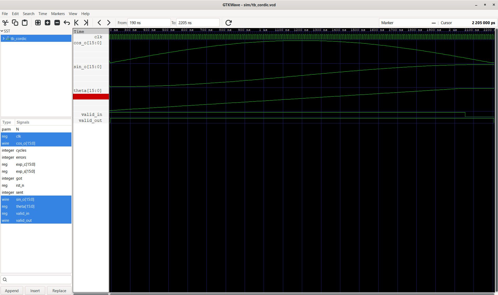
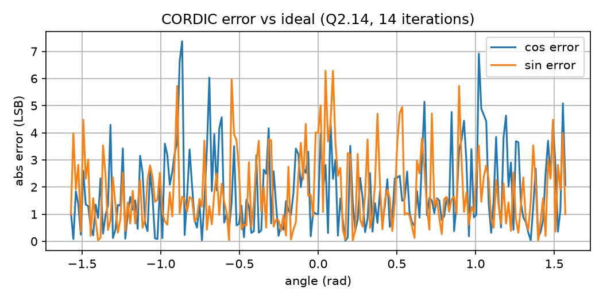
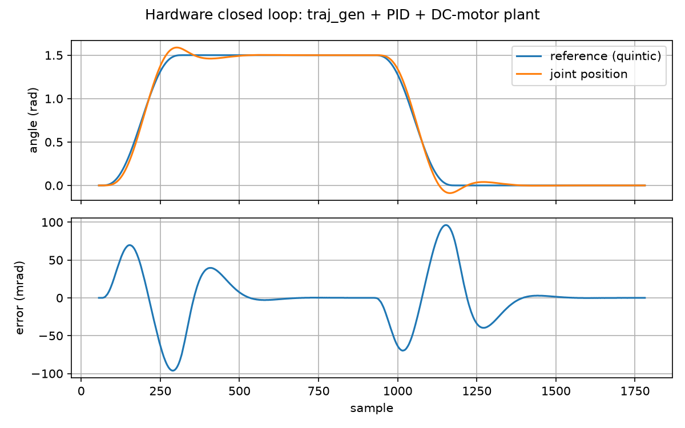
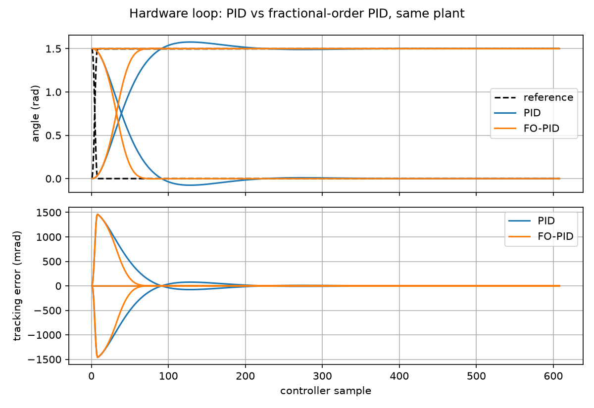

# Verilog Motion Control Engine for Coordinated Robotic Arms

A hardware motion-control pipeline written in Verilog: CORDIC trigonometry, 2-link inverse/forward kinematics, quintic trajectory generation, PID and fractional-order PID joint control, and motor peripherals. Every block is verified bit-for-bit against a Python golden model with a self-checking testbench (automatic PASS/FAIL).
Host cmd (UART) -> cmd parser -> quintic trajectory generator
-> CORDIC kinematics (IK/FK) -> joint controller (PID / FO-PID)
-> PWM -> motor plant model
^ quadrature encoder decoder (feedback)

## Status

| Block | Verified | Notes |
|---|---|---|
| CORDIC sin/cos (rotation) | bit-exact, 201 vectors | Q2.14, 14 iterations, 15-clock latency, 1 result/clk |
| CORDIC atan2/magnitude (vectoring) | bit-exact, 1120 vectors | 4 guard bits, full +-pi range |
| Integer square root | bit-exact, 2015 vectors | 16-clock latency, no multipliers |
| 2-link forward kinematics | bit-exact, 1500 vectors | 17-clock latency |
| 2-link inverse kinematics (elbow-down) | bit-exact, 2000 vectors | 37-clock latency, reciprocal multiply instead of divider |
| Quintic trajectory generator | bit-exact, 6168 samples | velocity/acceleration limits via step count |
| PID with anti-windup | bit-exact, 4556 samples | clamped integrator, saturated output |
| Fractional-order PID (Grunwald-Letnikov, M=16) | bit-exact, 4556 samples | serial MAC, 18-clock latency |
| Quadrature decoder, PWM (dead time), UART + parser | self-checking testbenches | see `tb/` |
| Closed loop (trajectory + controller + plant) | simulation | see results below |

Not done yet: UART command path into the top level, two-arm coordination, hardware run on a real board.

## Results

### Kinematics accuracy (hardware IK -> FK round trip, 2000 targets, reach 550 mm)
- Max position error: 5.83 LSB = **0.65 mm**
- RMS position error: 1.64 LSB = about 0.18 mm
- Design finding: keeping the squared distance at full precision cut IK angle error about 9x versus truncating it (5.4e-3 rad to 5.8e-4 rad).

### Fixed-point analysis
- CORDIC vectoring, max angle error vs guard bits: 19.7 LSB (0 guard bits), 6.2 (1), 3.9 (2), 2.5 (3), 2.0 (4), no gain beyond 4. See `results/vec_guard_sweep.csv`.
- Quintic trajectory, max position error vs fraction bits: 8.3 LSB at 16 bits, 1.3 LSB at 20, flat beyond. See `results/traj_fsweep.csv`.

### PID vs fractional-order PID (honest comparison)
Quintic tracking RMS error on the same simulated DC-motor plant:

| Plant gain | Best-tuned PID | Best-tuned FO-PID |
|---|---|---|
| x0.5 | 32.3 LSB | 34.6 LSB |
| x1.0 (nominal) | **9.6 LSB** | 16.2 LSB |
| x2.0 | 22.6 LSB | 21.5 LSB |

- A well-tuned PID wins at nominal and the two are about tied under plant-gain variation. FO-PID was not shown to help on this noise-free linear plant.
- An earlier comparison against an untuned PID made FO-PID look about 5x better; that came from the PID tuning, not the controller, and is not claimed here.
- The short-memory fractional integral leaks, leaving about 8 LSB steady-state error.
- The FO-PID grid searched a narrower gain range than the PID grid (limitation).
- Sweeps: `results/pid_tuning_sweep.csv`, `results/fopid_sweep.csv`, `results/fopid_memory_sweep.csv`. Memory length M=16 matched M=256 within noise.

<!-- HWLOOP_START -->
### Hardware closed loop: tuned PID vs FO-PID (RTL simulation)
Same quintic move, same plant, one controller sample every 32 clocks.

| Move target | Controller | Max err (LSB) | RMS err (LSB) | Overshoot (LSB) | Final err (LSB) |
|---|---|---|---|---|---|
| 12288 | PID | 82 | 33.0 | 15 | 2 |
| 12288 | FO-PID | 180 | 73.6 | 95 | 3 |
| 0 | PID | 83 | 33.3 | 16 | 2 |
| 0 | FO-PID | 171 | 72.3 | 104 | 3 |

- PID uses the tuned gains from the sweep (Kp=16, Ki=0, Kd=2400).
- FO-PID is the verified hardware build (lambda=mu=0.6, M=16) with the original gains, not the best gains from the sweep, so it is not tuned.
- This is therefore a tuned-PID vs untuned-FO-PID comparison. The fair best-vs-best result is the table above, from the Python model.
<!-- HWLOOP_END -->

<!-- ARM_START -->
### Two-joint arm, end to end (RTL simulation)
Target (x, y) -> inverse kinematics -> two joint axes (quintic trajectory + PID, each with its own simulated DC-motor plant) -> forward kinematics on the final joint angles.

| Target (Q2.14) | Reached | Error | Final joints (Q3.13) |
|---|---|---|---|
| (6000, 3000) | (6000, 2999) | 0.11 mm on a 550 mm reach | -1552, 12038 |

- Single-target example; see the multi-target test below. Elbow-up is not covered.
- Both joints use the same step count, so they arrive together.
- The PID in the axis module uses the original (untuned) gains.
<!-- ARM_END -->

<!-- ARMMULTI_START -->
### Two-joint arm, multi-target test (RTL simulation)
24 targets spread across the reachable ring, run back to back (each move starts from the previous pose).

- Max end-point error: **0.25 mm** on a 550 mm reach
- RMS end-point error: **0.17 mm**
- Elbow-down solution only. Both joints use the same step count. The PID in the axis module uses the original (untuned) gains.
<!-- ARMMULTI_END -->

### Synthesis (Yosys, Xilinx 7-series mapping, estimates only)
| Module | LUTs | FFs | DSP48 |
|---|---|---|---|
| cordic_pipe | 647 | 585 | 0 |
| cordic_vec | 928 | 743 | 0 |
| isqrt_pipe | 591 | 586 | 0 |
| kin_fk | 1,475 | 1,236 | 2 |
| kin_ik | 3,488 | 2,981 | 7 |
| traj_gen | 491 | 176 | 40 |
| pid_ctrl | 233 | 66 | 4 |
| fopid_ctrl | 652 | 483 | 14 |

These are Yosys estimates, not Vivado results. `traj_gen` uses 40 DSPs because its multiplies are written 64 bits wide; narrowing them is a known optimization.

### Timing (nextpnr-ice40, HX8K, no pin constraints)
| Module | Fmax | Logic cells |
|---|---|---|
| cordic_pipe | 150.2 MHz | 1,859 / 7,680 |
| cordic_vec | 128.5 MHz | 2,370 / 7,680 |
| isqrt_pipe | 114.3 MHz | 749 / 7,680 |

Measured on a small, slow FPGA family; other devices will differ.

## Figures

*The last figure uses the tuned PID against the hardware FO-PID build (original gains).*

## Reproduce
Requires Icarus Verilog, Python 3 (numpy, matplotlib), Yosys.
./scripts/run_cordic.sh # sin/cos
./scripts/run_cordic_vec.sh # atan2/magnitude
./scripts/run_kin_fk.sh # forward kinematics
./scripts/run_kin_ik.sh # inverse kinematics
./scripts/run_roundtrip.sh # IK -> FK round trip
./scripts/run_traj.sh # trajectory generator
./scripts/run_pid.sh # PID
./scripts/run_fopid.sh # fractional-order PID
./scripts/run_loop1.sh # closed loop
./scripts/synth_all.sh # Yosys synthesis

## Layout
`rtl/` Verilog, `tb/` testbenches and vectors, `model/` Python golden models, `scripts/` run scripts, `results/` tables, plots, synthesis reports, `docs/` figures.

## Limitations
- Plant models are simulation-only; nothing has run on real hardware.
- Closed-loop tests step the plant once per controller sample with one extra sample of delay versus the Python model.
- The first closed-loop plot (`loop1`) uses the untuned PID; the PID vs FO-PID plot uses the tuned PID.
